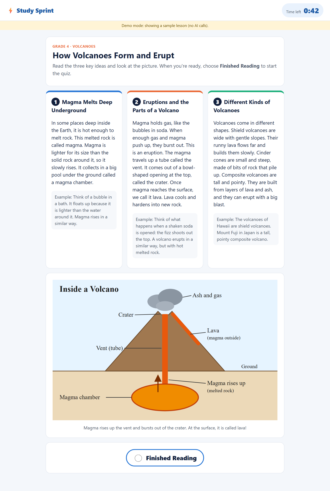
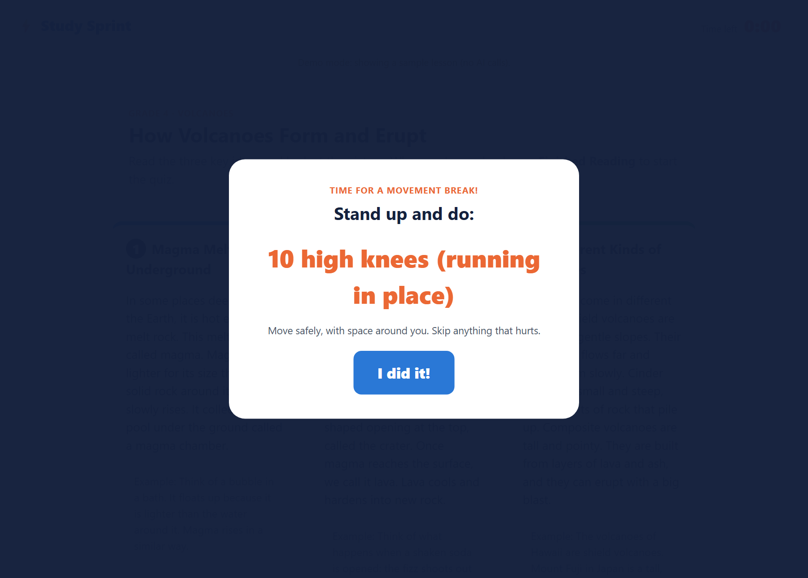
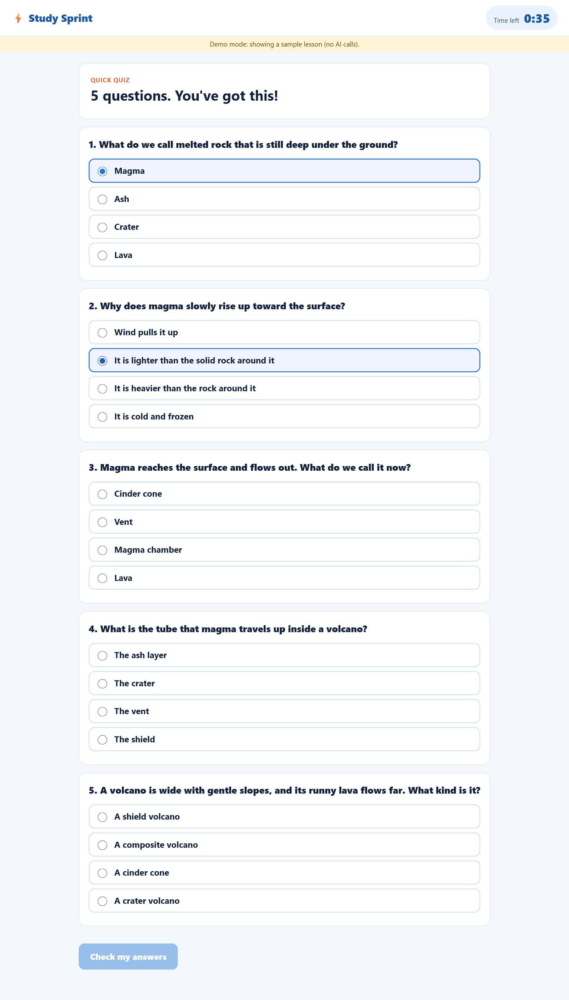
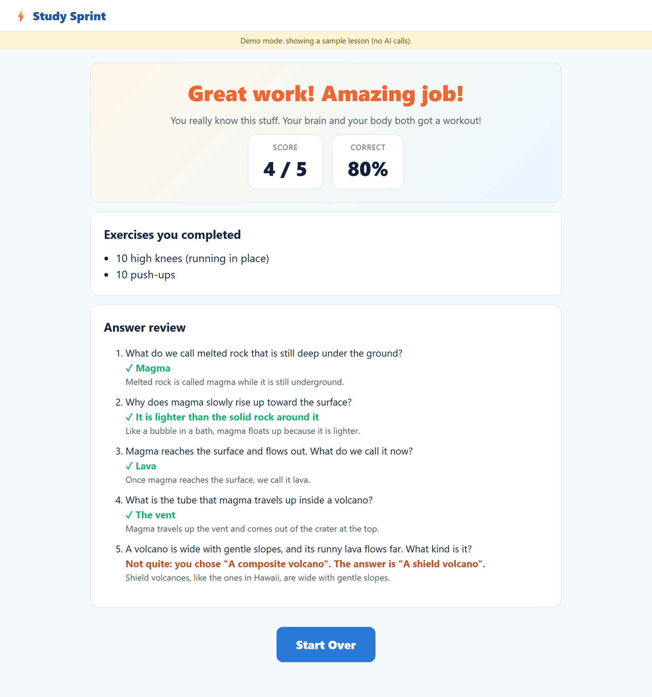
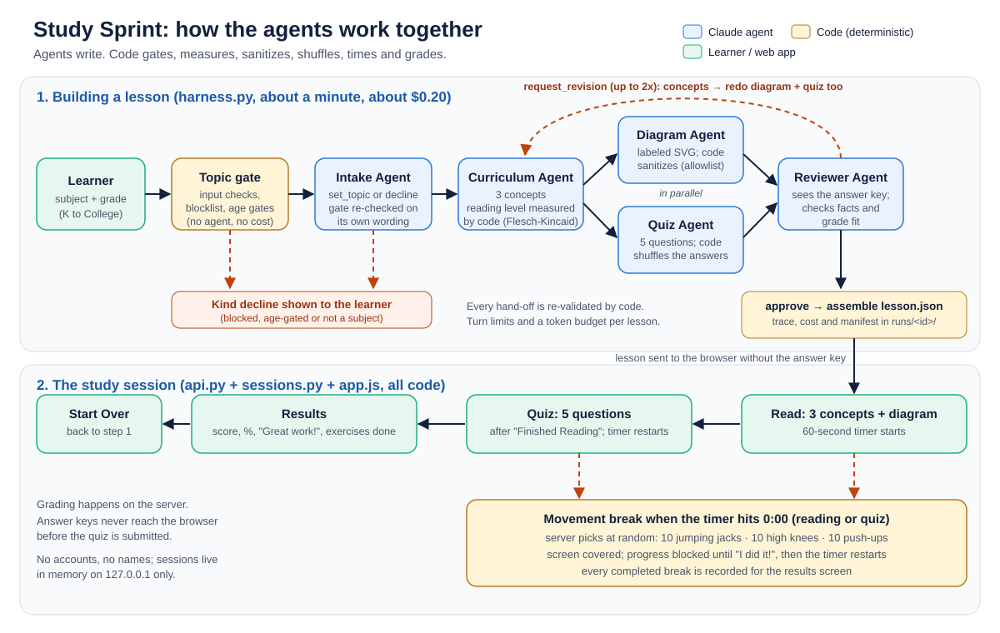
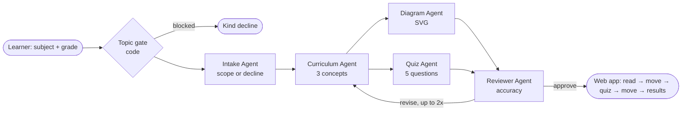

# Study Sprint

[](https://github.com/emitby/Study-Sprint/actions/workflows/ci.yml)


[](LICENSE)

**A multi-agent study app with movement breaks.** Pick any subject and a grade from Kindergarten to College. Five Claude agents build a lesson at the right level: **three key concepts**, a **labeled diagram** and a **5-question quiz**. A **1-minute timer** runs while you read and while you take the quiz. When it runs out, you do a random exercise (10 jumping jacks, 10 high knees or 10 push-ups) before continuing. The results screen celebrates your score and lists the exercises you completed.

**→ [How it works (12-page PDF with screenshots)](docs/how-it-works.pdf)** · [Screenshot gallery](docs/screenshots.md) · [Agent workflow](docs/workflow.md)

<p align="center">
  
  
  
  
</p>

## How it works



The same flow as a Mermaid chart:



| Step | What happens | Done by |
|---|---|---|
| 1. Choose | Type a subject and pick a grade (K, 1–12, College) | Learner |
| 2. Build | Topic gate, then five agents write and cross-check the lesson (about a minute) | Code + agents |
| 3. Read | Three concept cards and a diagram, with a 60 s countdown | Learner |
| 4. Move | At 0:00, a random exercise. "I did it!" restarts the timer. | Code picks, learner moves |
| 5. Quiz | Select **Finished Reading**, then answer 5 questions (same timer and breaks) | Learner |
| 6. Celebrate | Score, percentage, "Great work!", the exercises done and an answer review. **Start Over** goes back to step 1. | Code grades |

**Agents decide and write; code checks and computes.**
- The agents write the topic, the concepts, the SVG diagram, the questions and the review.
- Code does the rest:
  - safety gate
  - reading-level measurement
  - SVG sanitizing
  - answer shuffling
  - exercise choice
  - timers
  - grading
  - every hand-off check

## Quick start

Requires Python 3.10+. Live lessons need an [Anthropic API key](https://console.anthropic.com/) in `ANTHROPIC_API_KEY`. Demo mode needs none.

```powershell
python -m venv .venv
.venv\Scripts\python.exe -m pip install --no-cache-dir -r requirements.txt -e .
.\run.ps1 install-browser        # Chromium for tests/screenshots, installed INSIDE the project

.\run.ps1 serve --demo           # sample lessons, no API key -> http://127.0.0.1:8000
.\run.ps1 serve                  # live agents (about $0.20 and about a minute per lesson)
```

On macOS or Linux, use `./run.sh` with the same commands.

| Command | What it does |
|---|---|
| `.\run.ps1 test` | Unit, API and browser end-to-end tests (offline, free) |
| `.\run.ps1 build "volcanoes" --grade 4` | Build one lesson from the command line; artifacts in `runs/<id>/` |
| `.\run.ps1 eval` | Score the latest build, plus the guardrail red-team (free) |
| `.\run.ps1 eval --live` | Build a Kindergarten-to-College matrix with live agents and report pass rates |
| `.\run.ps1 guide` | Re-take the screenshots and rebuild `docs/how-it-works.pdf` |

> **Always use the launcher.** It keeps Python's bytecode cache and Playwright's browsers inside the project, as the [CLAUDE.md](CLAUDE.md) guardrails require.

## Results

Live eval matrix with the real agents, Kindergarten to College (2026-10-21, after fixes):

| Subject (grade) | Topic chosen by the Intake Agent | Cost | Time | Scorers |
|---|---|---|---|---|
| shapes (K) | Basic Shapes All Around Us | $0.13 | 33 s | 8/8 |
| the water cycle (2) | How the Water Cycle Works | $0.16 | 51 s | 8/8 |
| fractions (4) | Understanding and Comparing Fractions | $0.15 | 44 s | 8/8 |
| photosynthesis (5) | How Plants Make Food: Photosynthesis | $0.19 | 59 s | 8/8 |
| ancient Egypt (6) | Daily Life in Ancient Egypt | $0.17 | 48 s | 8/8 |
| science (7, too broad) | Cells: The Building Blocks of Life | $0.20 | 60 s | 8/8 |
| World War II (10) | World War II: Causes and Major Events | $0.22 | 77 s | 8/8 |
| derivatives (College) | Introduction to Derivatives in Calculus | $0.27 | 84 s | 8/8 |
| asdfghjkl (3) | Declined kindly, as expected | $0.01 | 4 s | n/a |

**9/9 outcomes as expected, with 100% on every scorer.** Also passing: 185 tests (unit, API and browser end-to-end) and 45/45 red-team cases.

The first matrix run went 8/9. The Reviewer Agent caught a real factual error in the ancient Egypt lesson. Then, after the concepts were revised, it caught a diagram that contradicted them, because the harness hadn't redrawn it. A concepts revision now redoes the diagram and the quiz. Details: [docs/evals.md](docs/evals.md).

## Documentation

| Document | Contents |
|---|---|
| [docs/how-it-works.pdf](docs/how-it-works.pdf) | Illustrated guide: every screen, the agents, guardrails and evals ([what's in it and how it's generated](docs/pdf-guide.md)) |
| [docs/workflow.md](docs/workflow.md) | **How the agents work together:** the workflow diagram, each step, a build sequence diagram, the session state machine |
| [docs/screenshots.md](docs/screenshots.md) | Every screen of a full session, at full size |
| [docs/architecture.md](docs/architecture.md) | Components, request flow, data model, run directory |
| [docs/agents.md](docs/agents.md) | Each agent's job, tool, prompt rules and what code enforces |
| [docs/harness.md](docs/harness.md) | Orchestration, hand-off validators, revisions, limits, tracing and cost |
| [docs/guardrails.md](docs/guardrails.md) | Each harm, the guardrail that prevents it, its tests and its limits |
| [docs/evals.md](docs/evals.md) | Tests, scorers, red-team, live matrix, and what each found |
| [tasks/todo.md](tasks/todo.md) · [tasks/lessons.md](tasks/lessons.md) | Build plan and lessons learned (kept per CLAUDE.md) |

## Project layout

```
studysprint/        app package (every module, class and function documented)
  config.py           grades, reading-level bands, timer, exercises, agent settings
  paths.py            confinement and atomic writes (no `os`, no deletions)
  safety.py           subject validation, topic gate, output safety checks
  readability.py      Flesch-Kincaid grade level, computed by code
  svg_sanitize.py     allowlist validation and canonicalization of agent SVG
  lesson.py           lesson model and rules (concepts, quiz, answer shuffling)
  sessions.py         reading → quiz → results flow, breaks, server-side grading
  exercises.py        random exercise choice and the results summary
  harness.py          pipeline, hand-off validators, revisions, manifest
  api.py  cli.py  guide.py
  agents/             runtime.py + intake, curriculum, diagram, quiz, reviewer agents
  static/             index.html, app.js, style.css (no build step, no CDN)
  fixtures/           demo lessons (one hand-written, one from a live build)
evals/              scorers.py, redteam.py, run_evals.py
tests/              unit, API and Playwright end-to-end tests (scripted fake Claude client)
docs/               guides and how-it-works.pdf
runs/<id>/          one folder per lesson build: lesson.json, review.json, trace.jsonl, manifest.json
```

## Safety and privacy

- **Built for children.** Unsafe subjects are blocked before any agent runs, and some topics are age-gated.
- **Every sentence checked.** Everything the agents write is checked for links, contact details, requests for personal information and unkind words.
- **Diagrams can't run code.** They're sanitized, then shown as images.
- **The answer key stays on the server** until the quiz is graded.
- **No accounts.** No names or personal data are collected, and sessions live only in memory.
- **Runs locally.** The server binds to `127.0.0.1` only.

Movement breaks are suggestions: the app reminds learners to move safely and skip anything that hurts.

## License

[MIT](LICENSE)
