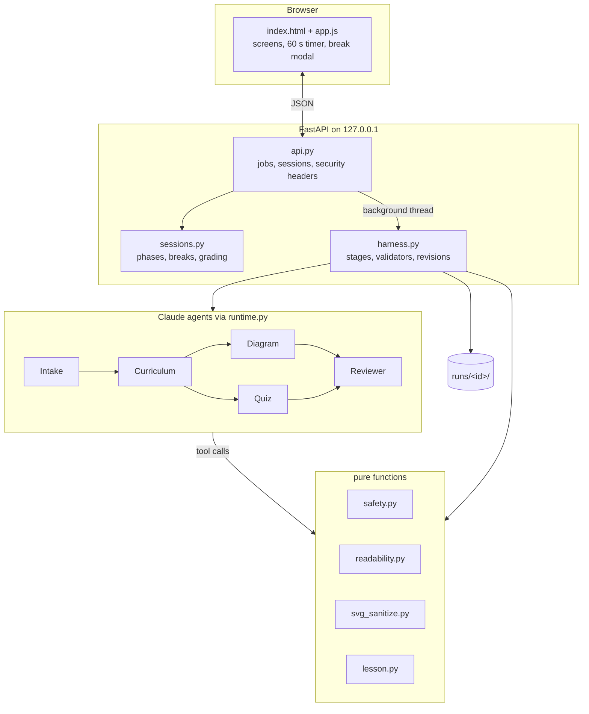

# Architecture

Study Sprint has three layers:
1. **Web app:** a FastAPI backend and a static front end.
2. **Harness and agents:** five Claude agents run by deterministic orchestration code.
3. **Rules:** pure functions that decide what is acceptable, shared by the agents' tools, the harness, the API and the evals.

## Request flow

1. `POST /api/lessons {subject, grade}`
   - The subject is validated (`validate_subject`), then the topic gate runs (`topic_gate`).
   - A blocked subject returns `declined` at once, with no agent call and no cost.
   - Otherwise a **job** starts in a background thread, and the browser polls `GET /api/lessons/{job}` for the current stage.
2. The harness runs the agents (see [harness.md](harness.md)) and returns a validated `Lesson`.
3. The API opens a **session** and returns `lesson.public_view()`: concepts, the diagram, and questions **without answer keys**.
4. The browser shows the reading screen and starts the countdown (`Date.now()` against a deadline). At zero it calls `POST /sessions/{id}/break`; the server picks the exercise with `secrets.choice` and records it.
5. "I did it!" calls `POST /break/{bid}/done`, and the timer restarts. While a break is pending, the server refuses `finish-reading` and `submit`.
6. Selecting **Finished Reading** calls `POST /finish-reading`, which opens the quiz with the same timer and breaks.
7. `POST /submit {answers}`: the server grades and returns:
   - score and percentage
   - an enthusiastic headline (`results_message`)
   - the answer review
   - the exercises completed (`exercises.summarize`)
8. **Start Over** resets the page to the start screen.

## Data model (`lesson.py`)

| Model | Fields | Notes |
|---|---|---|
| `Concept` | title, explanation, example | Exactly 3 per lesson |
| `Diagram` | svg, alt_text, caption, labels | `svg` is the sanitizer's canonical output |
| `Question` | question, options[4], answer_index, concept_index, why | `answer_index`, `concept_index` and `why` are server-side until grading |
| `Lesson` | id, subject, topic, grade, concepts, diagram, questions, meta | `public_view()` is the only form sent before grading |

## Run directory (`runs/<timestamp>-<slug>-g<grade>/`)

| File | Written by | Contents |
|---|---|---|
| `trace.jsonl` | runtime, harness | Every model call (usage, latency, stop reason), every tool call (input, ok/error) and stage timings |
| `lesson.json` | harness | The published lesson (with answer keys) |
| `review.json` | harness | The Reviewer's final verdict and notes |
| `manifest.json` | harness, always (even on failure) | Status, error, model, subject, grade, topic, seconds, tokens, cost, cost per agent |

## Design decisions

| Decision | Why |
|---|---|
| Five narrow agents instead of one | Each has one tool and one job, so each can be validated precisely and retried cheaply. Diagram and Quiz run in parallel. |
| Code shuffles answer positions | Answer-position bias becomes impossible by construction, and the agent never has to reason about positions |
| Reading level measured, not claimed | Flesch–Kincaid is computed by code from the text, against a per-grade range |
| SVG validated, re-serialized, then shown as `` | Three independent barriers against script execution |
| Timer in the browser, facts on the server | The countdown must be smooth and testable (Playwright clock). Exercises, completion and grading must be trustworthy. |
| Demo mode with fixtures | Tests, screenshots and offline use with no key or cost. One fixture is real agent output. |
| No `os`, everything confined | The [CLAUDE.md](../CLAUDE.md) guardrails. Launchers set cache paths before Python starts. |
