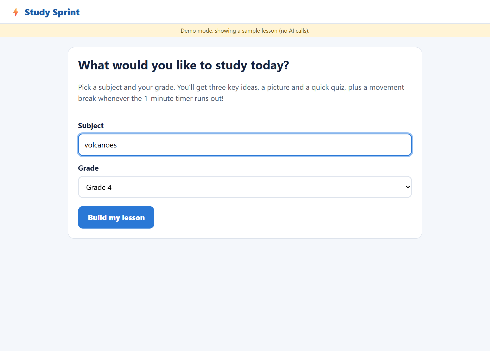
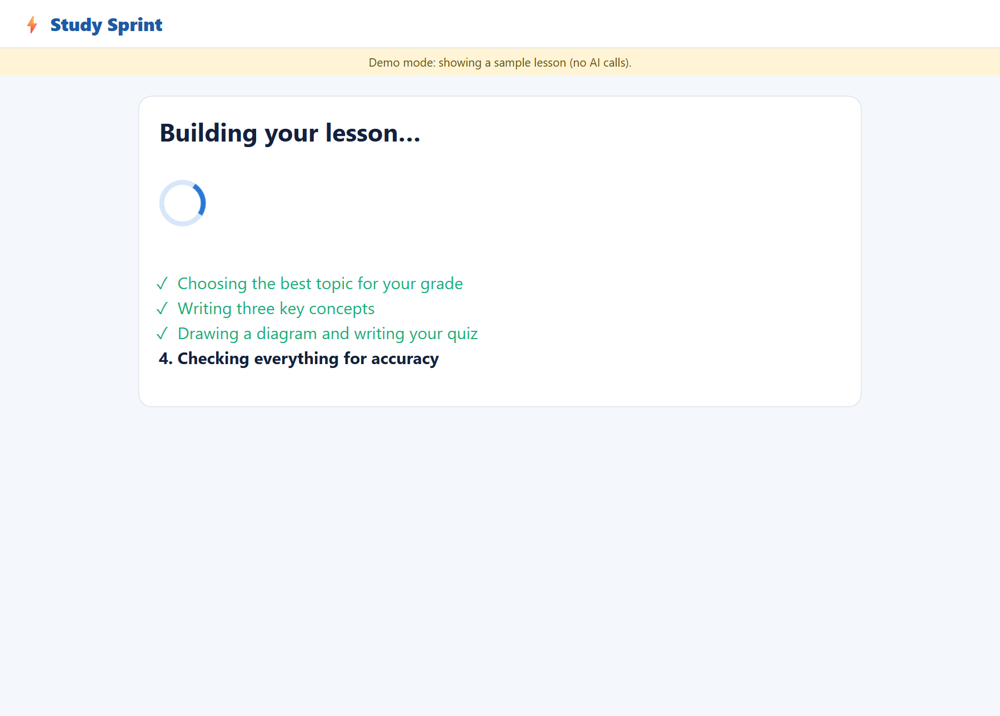
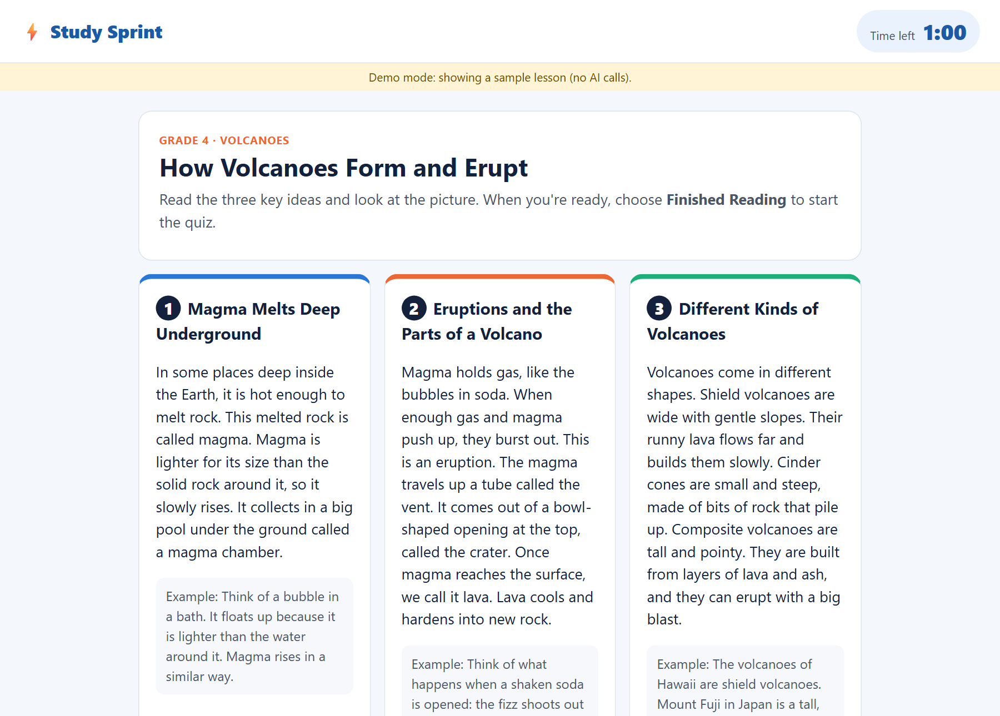
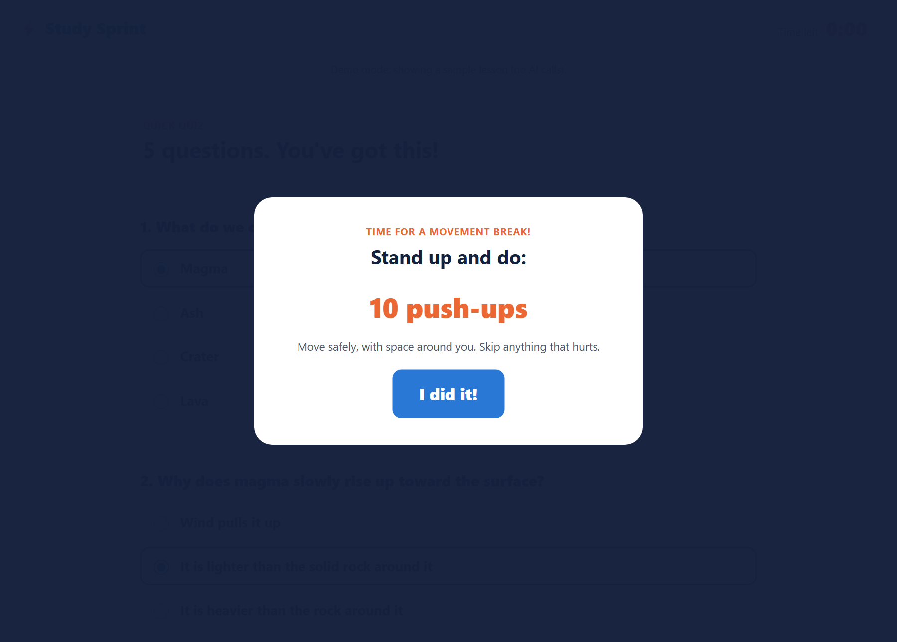
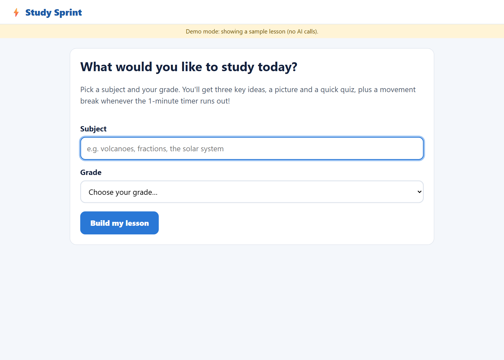
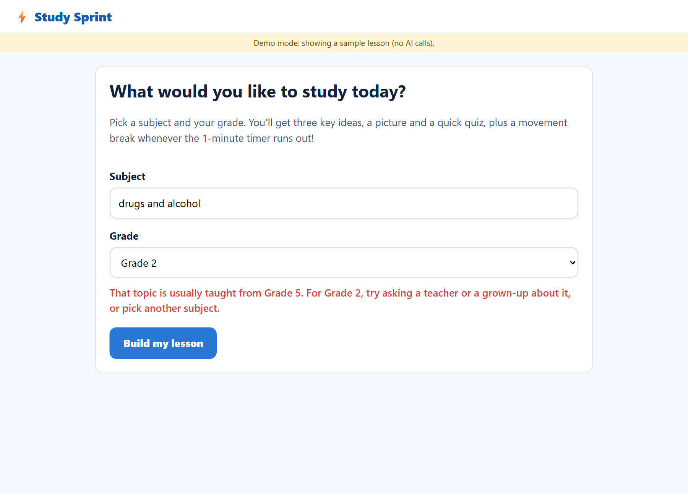
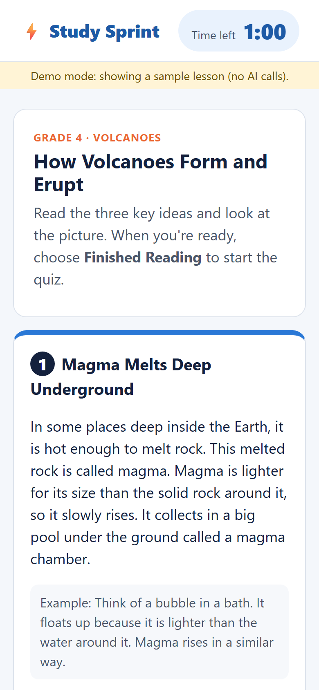

# Screenshots

All screenshots are generated by `.\run.ps1 guide`. It drives a real Chromium through one complete study session with Playwright, fast-forwarding the 1-minute timers with Playwright's clock. The lesson is "How Volcanoes Form and Erupt" (Grade 4), saved from a live agent build (lightly edited after review), replayed in **demo mode** so the screenshots are reproducible without API calls.

## 1. Choose a subject and grade

## 2. The agents build the lesson

## 3. Read three key concepts and the diagram (timer running)

## 4. A minute passes: movement break

After **I did it!** the lesson returns and the timer restarts at 1:00:

## 5. "Finished Reading" opens the quiz

## 6. A minute passes during the quiz: another break
The exercise is picked at random by the server, so it often differs from the last one.

## 7. Results
Score, percentage, an enthusiastic "Great work!", every exercise completed and a gentle answer review:

## 8. Start Over

## Safety: a kind decline
Subjects that aren't right for the learner's grade are declined before any agent runs:

## Phone layout

