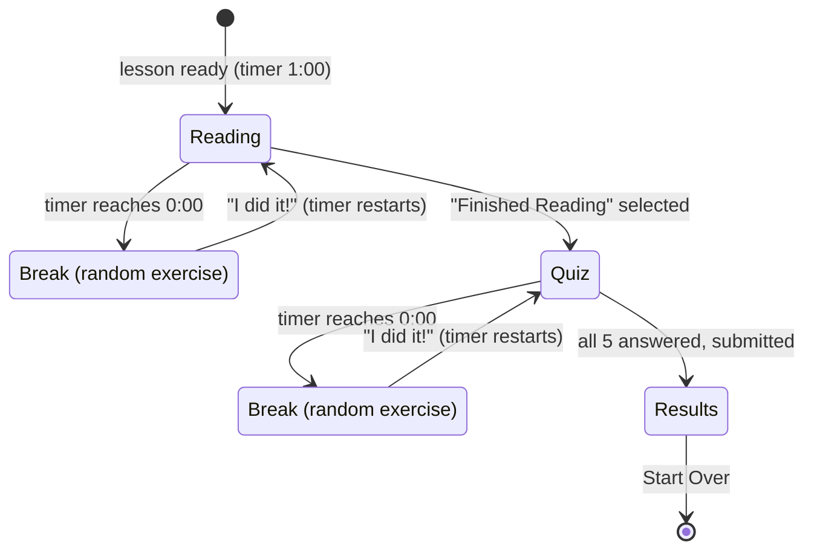

# How the agents work together


Study Sprint has two phases:
1. **Building a lesson:** five Claude agents, orchestrated by deterministic code.
2. **The study session:** plain code, no agents.

Agents only *write*. Code decides the flow, checks every hand-off, measures reading level, sanitizes the diagram, shuffles the answers, picks the exercises, runs the timers and grades the quiz.

## Phase 1: building a lesson (`studysprint/harness.py`)

| # | Step | Who | Input → output | What can stop it |
|---|---|---|---|---|
| 0 | **Input validation** | Code (`safety.validate_subject`) | Raw text → a clean subject | Too short or too long, odd characters, injection phrasing ("ignore previous instructions") |
| 1 | **Topic gate** | Code (`safety.topic_gate`) | Subject + grade → allowed or a kind reason | Hard-blocked topics (any grade), age-gated topics below their grade. **No agent runs and no cost.** |
| 2 | **Intake Agent** | Claude (low effort, 4 turns) | Quoted subject + grade → a specific topic and scope, or a decline | The agent declines non-subjects. `set_topic` re-runs the gate on the agent's own wording. |
| 3 | **Curriculum Agent** | Claude (medium, 8 turns) | Topic, scope, level targets → **3 concepts** | `concept_problems`: exactly 3, word counts, **Flesch–Kincaid computed by code**, sentence length, safety. Errors quote the measured numbers. |
| 4a | **Diagram Agent** (in parallel) | Claude (medium, 8 turns) | Concepts → **labeled SVG**, alt text, caption | `check_svg`: element and attribute allowlist, no scripts, links or styles, viewBox, ≥3 labels, size limits |
| 4b | **Quiz Agent** (in parallel) | Claude (medium, 8 turns) | Concepts → **5 questions** (correct answer, 3 distractors, cited concept, "why") | `quiz_problems`: distinct options, every concept tested, reading level, no praise openers, safety |
| 5 | **Reviewer Agent** | Claude (medium, 4 turns) | The whole lesson **with the answer key** → approve, or a revision of one part | Factual errors, wrong answer keys, grade fit, a diagram that doesn't match the concepts |
| 6 | **Revision loop** | Code (`harness.revise`) | Reviewer issues → the targeted agent re-runs with the issues appended | Up to 2 rounds. **A concepts revision also redoes the diagram and quiz.** A final rejection fails the build. |
| 7 | **Assemble** | Code (`harness.assemble`) | Validated parts → `Lesson` | Answer positions are shuffled with `secrets` here, never by an agent |

Every stage writes to a shared `BuildContext` through its tool. The harness re-checks each output with the same rule functions (**hand-off validators**) before the next stage starts. `runs/<id>/` receives `trace.jsonl`, `lesson.json`, `review.json` and `manifest.json` (written even on failure).

### Sequence of one build

```mermaid
sequenceDiagram
    participant B as Browser
    participant A as API
    participant H as Harness
    participant I as Intake
    participant C as Curriculum
    participant D as Diagram
    participant Q as Quiz
    participant R as Reviewer
    B->>A: POST /api/lessons {subject, grade}
    A->>A: validate_subject + topic_gate
    A-->>B: job_id (or immediate decline)
    A->>H: build_lesson (background thread)
    H->>I: quoted subject + grade
    I-->>H: set_topic (gate re-checked)
    H->>C: topic + level targets
    C-->>H: submit_concepts (FK measured; retry on error)
    par in parallel
        H->>D: concepts
        D-->>H: submit_diagram (sanitized)
    and
        H->>Q: concepts
        Q-->>H: submit_quiz (validated)
    end
    H->>R: full lesson + answer key
    alt approved
        R-->>H: approve
    else problem found (up to 2x)
        R-->>H: request_revision(target, issues)
        H->>C: revise (then redo D and Q if concepts)
        H->>R: review again
    end
    H-->>A: Lesson (shuffled answers) + run artifacts
    loop every 700 ms
        B->>A: GET /api/lessons/{job}
        A-->>B: stage name, or ready + lesson without answer keys
    end
```

## Phase 2: the study session (`api.py`, `sessions.py`, `static/app.js`)



| Event | Browser | Server |
|---|---|---|
| Lesson shown | Renders concepts and the diagram (as ``), starts a 60 s countdown against a deadline | Session created (random 128-bit ID, in memory) |
| Timer hits 0:00 | Stops the timer, `POST /break`, covers the screen with the exercise | `secrets.choice` of 10 jumping jacks, 10 high knees or 10 push-ups. Recorded as pending. Idempotent. |
| "I did it!" | `POST /break/{id}/done`, then restarts the timer at 1:00 | Marks the break completed |
| "Finished Reading" | `POST /finish-reading`, renders the quiz, restarts the timer | Phase `reading` → `quiz`. **Refused while a break is pending.** |
| Submit | `POST /submit {answers}` | Validates, **grades on the server**, picks a positive headline, summarizes the completed exercises |
| Start Over | Resets the page and the form | (The old session simply expires) |

## Why this split

- **Agents for judgment and writing:** choosing the right topic for a grade, explaining it, drawing it, asking good questions, spotting a factual error.
- **Code for anything that must be guaranteed:** safety gates, reading level, SVG safety, answer placement, randomness, timing and grading.
- **One rule set, used everywhere.** The validators an agent's tool calls are the same functions the harness, the API and the evals use (`lesson.py`, `safety.py`, `svg_sanitize.py`).

See also: [harness.md](harness.md) · [agents.md](agents.md) · [guardrails.md](guardrails.md) · [evals.md](evals.md)
